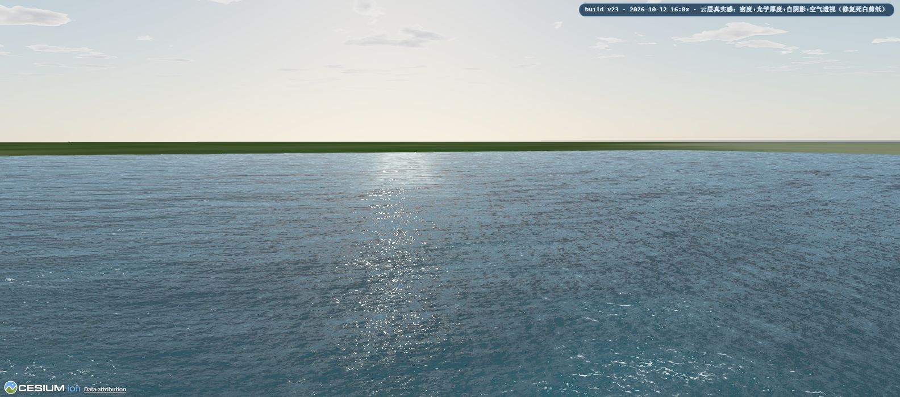
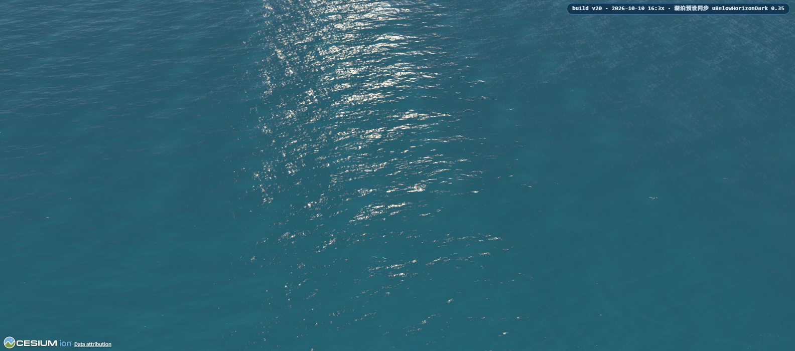
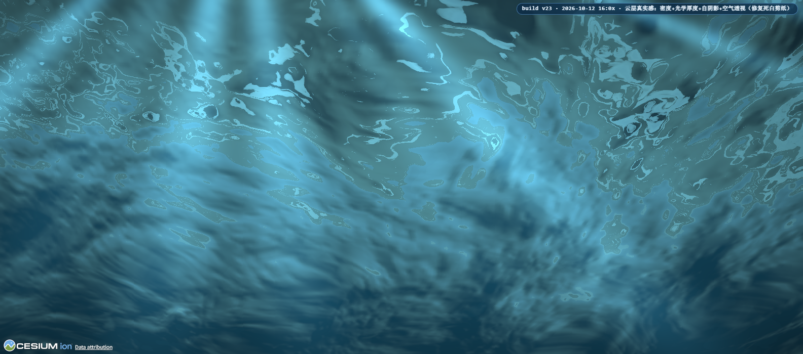
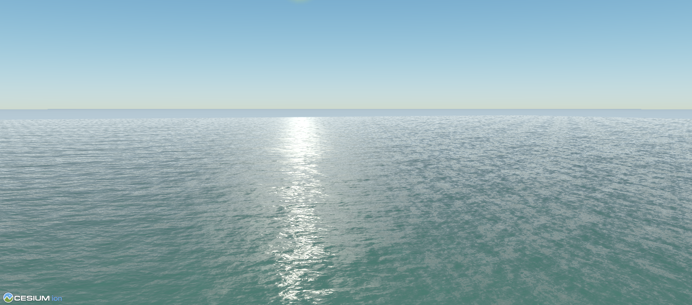
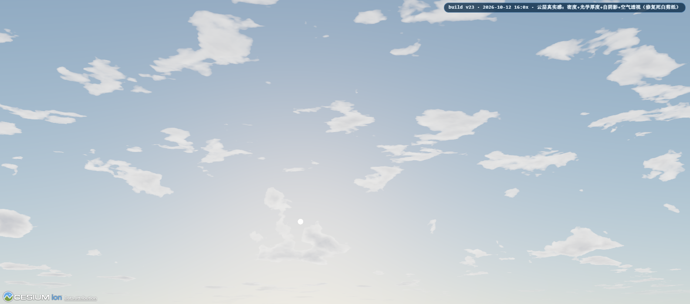
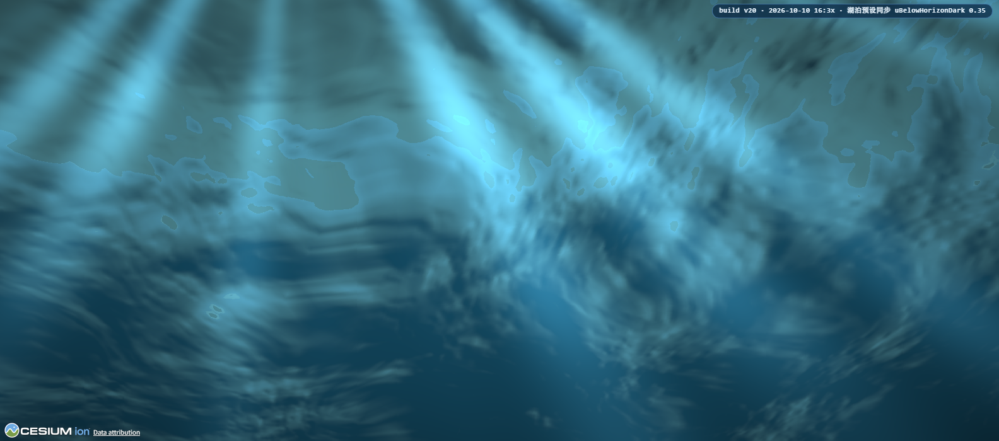
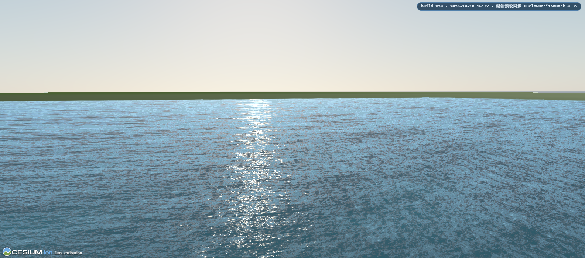

# UE5 SingleLayerWater 近似 · Cesium CustomShader 高性能水面

用 Cesium `CustomShader` + `Model`（glTF 面片）复刻 UE5 `SingleLayerWater` 的单层水视觉：
菲涅尔、水体吸收/散射、四层法线滚动（涌浪 + 粗/中/细）、Gerstner 顶点波、太阳高光闪鳞、
浪峰泡沫，以及带光柱/斯涅尔窗的水下效果。另内置 **Frostbite 物理大气**
（Hillaire 2020：transmittance / multi-scattering 双 LUT 天空 + 物理气透视，
水面反射与天穹共享同一套物理）。
纯 Web 端实现，**零第三方依赖**，双击即用。



## 效果预览

以下均为 `_render_probe.cjs` 无头渲染实拍，无后期处理。

| 掠射 · 太阳光路 | 俯视 · 波场与闪鳞 |
| --- | --- |
|  |  |

| 水下 · 光柱与距离雾 | 湖泊预设 |
| --- | --- |
|  |  |

| Frostbite 大气 · 晨昏天光 | Frostbite 大气 · 水下 |
| --- | --- |
|  |  |

| Frostbite 大气 · 低太阳掠射水面（无灰白板） |
| --- |
|  |

## 快速开始

**看效果** —— 直接双击 `index.html`（全部代码内联，仅需联网加载 Cesium CDN）。
默认机位是「低空掠射 + 迎着太阳」，最能看出菲涅尔和太阳光路。

**接入项目** —— 引入 `ue5-water-material.js` 后调统一入口：

```js
// 可选但推荐：先建物理大气，再建水面 —— 水面要共享大气的 uniform，
// 反射 / 气透视 / 水下斯涅尔窗才能与天穹色调严格一致
const atmosphere = await Ue5Water.createAtmosphere(viewer, {
  site: { lon: 125.0, lat: 28.0, height: 1.0 },   // 地面半径取该点地心半径
  exposure: 40,                                   // 天空整体亮度总控
});

const water = await Ue5Water.createWater(viewer, {
  preset: 'ocean',        // 'ocean' | 'lake'
  planeSize: 8000,        // 面片边长（米）
  segments: 400,          // 细分
  normalTexSize: 256,
  site: { lon: 125.0, lat: 28.0, height: 1.0 },   // 经纬度 + 海平面高度
  atmosphere,             // 传入后水面走物理天空反射 + 物理气透视；不传 = 解析天空
});

water.setUniform('uGerstnerHeight', 3);   // 单个参数
water.applyPreset('lake');                // 整套预置
water.setTimeScale(2);                    // 整体快慢（0 = 静止）
water.pause();  water.resume();           // 暂停 / 继续

atmosphere.setEnabled(false);             // A/B：一键退回解析天空 + Cesium 天穹
atmosphere.setUniform('uAtmoExposure', 60);

// 可选：水下效果（相机入水会自动触发，也可手动切）
const underwater = Ue5Water.createUnderwater(viewer, { water });
underwater.setUnderwater(true);           // 入水（setUnderwater(false) 出水）
```

大气失败会自动降级：天穹退回 Cesium 自带，水面退回解析天空，启动链不中断。

## Demo 页面操作

- **参数面板（HUD）**：预设切换、太阳时刻、相机机位、全部 uniform 滑杆，右上角可折叠。
- **物理大气**：面板「Frostbite 物理大气」勾选框 = `setEnabled` 开关（A/B 对比），
  「大气曝光」滑杆 = `uAtmoExposure`。太阳时刻滑杆同时驱动物理大气的太阳方向。
  「物理大气 · 水面合成」一组的三个滑杆 = `uAtmoReflTint` / `uAtmoReflGain` / `uAtmoApScale`
  （解决低太阳掠射时中远景水面发灰白，见下文「常用参数速查」）。
- **底图**：公开影像服务（Esri 卫星 / OSM），**无需 Cesium ion token**；底图加载失败不影响水面。
- **波浪速度**：面板「运动速度」滑杆就是 `uTimeScale`，另有「暂停波浪」按钮。

## 常用参数速查

完整参数表与推导见 [docs/DEVNOTES.md](docs/DEVNOTES.md)。

| Uniform | 作用 |
| --- | --- |
| `uAbsorptionCoeff` / `uAbsorptionColor` | 每米吸收系数 + 深水基色 → "水色随深度变化"的关键 |
| `uScatteringColor` | 浅水散射色（正视水面时看到的颜色） |
| `uGerstnerHeight` | 浪高（Gerstner 总振幅，米） |
| `uTimeScale` | 动画整体快慢总控（0 = 静止） |
| `uSpecularIntensity` / `uSpecularAniso` | 太阳高光强度 / 各向异性拉伸（闪鳞感）。高光为 GGX 各向异性（UE `D_GGXaniso` + Schlick + Smith），长尾衰减 → "亮核 + 渐远银色尾迹" |
| `uFoamThreshold` | 浪峰泡沫阈值（越高泡沫越少）。海洋 0.40 / 湖泊 0.72 |
| `uCloudCover` / `uCloudSharp` / `uCloudSpeed` | 程序化云层：云量 0..1 / 不透明度斜率（小=薄透/大=厚实）/ 漂移速度。天穹、水面反射、水下斯涅尔窗三处同步（v21） |
| `uCloudHeight` / `uCloudScale` | **云层高度 m / 云团特征尺寸 m**（v22）。云是有高度的一层：缩放升降时云场真实收敛/发散，平移时云随地理位置滑动（真视差）；相机升到云层高度附近整体淡出 |

云的观感（v23）由四件事合成，缺一就假：**密度场**（大尺度团块 0.85 + 中尺度破碎 0.15，
细八度当侵蚀）→ **光学厚度**（`alpha = 1-exp(-密度×斜距)`，薄边半透、近地平线连成云海）→
**自阴影**（沿太阳方向偏移采样，亮边+灰蓝暗底）→ **空气透视**（远云溶进霾色）。
关键坑：云的辐亮度必须与天空同量级（曝光 40 时 col ∈ [0.06, 0.6]），一旦超量级
整个明暗区间被 Reinhard+伽马压进 0.85~0.97 的"死白带"，怎么调都是剪纸（实测）。
| `uAlpha` | 整体通透度 |
| `uEdgeFade` | 面片边缘羽化，让水面溶进下方真实影像 |
| `uAtmoExposure` | 物理大气曝光（天穹 + 水面反射 + 气透视同步生效） |
| `uAtmoReflGain` | **物理天空反射强度**（1 = 完全按物理；<1 压暗，让水色透出来。海洋默认 0.45） |
| `uAtmoReflTint` | **地平线反射色相校正**（向 `uHorizonColor` 靠，1 = 完全用它。海洋默认 0.60） |
| `uAtmoApScale` | **气透视强度**（1 = 标准 `color·T+S`，0 = 关闭） |

后三项只影响**水面**（天穹不读），默认值已按"低太阳 + 掠射"调好。物理大气在低太阳
高度角下，地平线天空本身就是**暖白**的（太阳光斜穿大气被红光化，数值实测 B-R≈-0.05），
而掠射水面 fresnel 0.6~0.9 ⇒ 水色几乎等于这层暖白天空；再加上物理气透视比旧解析雾强
20~50 倍（3 km 处入散射 0.27 vs 旧雾 0.56%），中远景水面会糊成一片**灰白板**。
`uAtmoReflTint` 用已有的 `uHorizonColor` 归一化到亮度 1 当色相滤镜（只改色相不改明暗，
且只在地平线附近生效），把反射拉回"海面该有的蓝"；`uAtmoReflGain` 把海压到天空之下
（远处的海始终比它上方的天空暗一截）；`uAtmoApScale` 把过强的气透视压回合理量。
三项都设 1 就是"完全按物理"的观感。

**波浪速度分两层**：`uGerstnerSpeed` 控制顶点浪的相速度，`uWaveSpeedLow/Mid/High`
控制法线纹理滚动；"整体快慢"只用动 `uTimeScale` 一个旋钮。

## 自检与调试

```bash
node _sync_inline.cjs --check    # index.html 内联副本是否与模块一致
node _verify_glb.cjs             # 静态自检：语法 / Cesium 属性 / glb 结构 / 法线贴图
node _atmosphere_check.cjs       # 大气 LUT 数值自检：Chapman 解析解对齐 + PNG 导出
node _render_probe.cjs           # 无头渲染：真跑页面 + 编译日志 + 截图（需本机 Chromium）
```

探针常用机位 / 参数：

```bash
node _render_probe.cjs                    # ocean 预设 / 掠射视角 → shot.png
node _render_probe.cjs --top              # 俯视视角
node _render_probe.cjs --preset lake      # 湖泊预设
node _render_probe.cjs --underwater       # 水下 6 m 仰视
node _render_probe.cjs --hour 10.25 --heading 295   # 太阳时刻 / 相机朝向
node _render_probe.cjs --basemap none     # 底图（esri-imagery / esri-ocean / osm / none）
node _render_probe.cjs --uniform uHazeDensity=3e-5  # 覆盖任意 uniform（可重复传）
```

> ⚠️ `index.html` 里 `/* ==BEGIN ue5-water-material.js== */ … /* ==END …== */` 之间是模块的
> 内联副本，**不要手改** —— 改完模块跑 `node _sync_inline.cjs` 重新注入。

## 目录结构

```
ue5-water-customshader/
├── index.html              ← 单文件完整 Demo（双击即开）
├── ue5-water-material.js   ← 模块版：可直接接入现有项目
├── screenshots/            ← 效果截图（本 README 引用）
├── docs/
│   └── DEVNOTES.md         ← 实现细节 / 参数推导 / 踩坑记录（开发向）
├── _sync_inline.cjs        ← 模块 → index.html 内联块同步
├── _verify_glb.cjs         ← 静态自检
├── _atmosphere_check.cjs   ← 大气 LUT 数值自检（Chapman 对齐 / 地平线连续性 / PNG）
├── _render_probe.cjs       ← 无头渲染探针（截图 / 编译日志 / 运动检测）
├── _tone_check.cjs         ← 截图色差量测（零依赖）
└── _lod_check.cjs          ← LOD 量测：每像素纹素数
```

## 已知局限

Cesium（WebGL / 前向渲染 / 单 Pass 模型）拿不到屏幕深度与场景颜色，因此
折射、真实水体厚度、SSR / 平面反射、岸边深度泡沫等 UE5 能力**无法直接实现**，
本实现用视角光程近似吸收/散射；反射默认走 Frostbite 物理天空（可 A/B 退回解析梯度）。
逐条受限点分析与绕法见 [docs/DEVNOTES.md](docs/DEVNOTES.md) §一。

## 排障速查

启动链内置进度上报 + 看门狗（每 5 秒报告当前步骤），失败会显式报错而非无声卡住：

| 现象 | 处理 |
| --- | --- |
| 卡在「加载 CesiumJS」 | CDN 不可达：换网络，或把 `Build/Cesium/` 下载到本地部署（见 DEVNOTES §六） |
| 卡在「检查运行环境」 | 浏览器不支持 WebGL2：换新版 Chrome / Edge，检查 `chrome://gpu` |
| 着色器编译报错（顶部红条） | 看控制台 `[step ✘]` 行；先跑 `node _verify_glb.cjs` 静态排查 |
| 天空全黑 / 天穹被雾盖住 | 确认未手动改 `scene.fog`；天穹依赖"包围球跟随相机"避开模型雾（createAtmosphere 内部处理） |
| 中远景水面成片**灰白**（低太阳 + 掠射） | 物理天空的地平线本身是暖白、且气透视比旧解析雾强 20~50 倍。调 `uAtmoReflTint`（↑ 更蓝）、`uAtmoReflGain`（↑ 反射更强）、`uAtmoApScale`（↓ 雾更薄）；三项都设 1 即完全按物理 |
| 水面**偏亮/蓝得发青**，不像真实海 | 反射太强。把 `uAtmoReflGain` 往下推（0.45 是深海向默认值，1.0 = 完全按物理），`uAtmoReflTint` 降到 0.4~0.6 可去掉人工青味。真实远海总比它上方的天空明显暗一截 |
| 背光波面发黑 | 反射方向落到地平线以下时物理积分的射线打到地面且地表辐射为 0。着色器已把反射射线钳到地平线再采样（§5），若仍见暗斑先确认 `uBelowHorizonDark` 未被调得过大 |
| 底图不显示 | 不影响水面；Esri/OSM 瓦片服务偶尔限流，稍后重试或切底图 |
