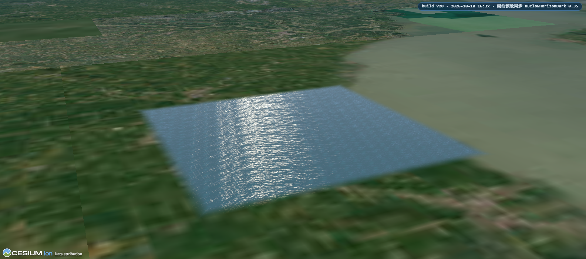
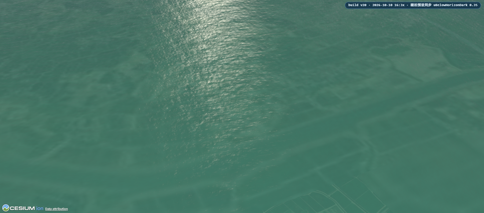
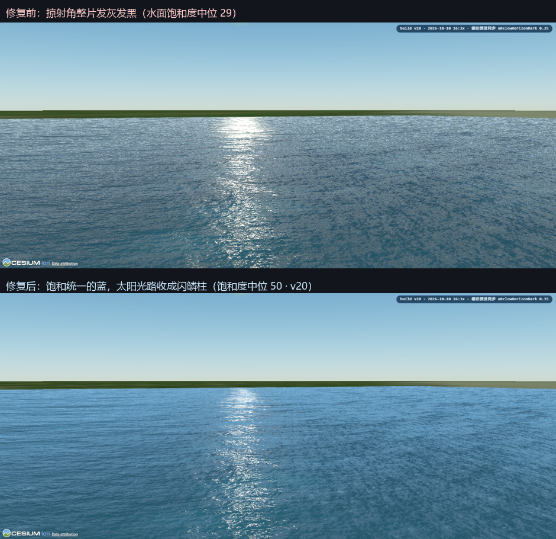

# 我在浏览器里复刻了 UE5 的水面 —— 以及把它修"蓝"的那些坑

> 一个 Cesium CustomShader 项目的水面渲染笔记：从"整片发灰"到"饱和统一的蓝"，
> 中间隔着九个坑、一张饱和度热力图，和一次用户亲手拖滑杆的破案。

## 起因

Cesium 的 globe 很好用，但它的水面从来不是主角：内置的 Water 材质偏"贴图风"，
拿不到 UE5 `SingleLayerWater` 那种质感——菲涅尔反射、随深度变色的吸收/散射、
太阳光路上碎银子一样的闪鳞、潜下去还有光柱和斯涅尔窗。

于是我写了一个 `CustomShader`：一块运行时生成的 glTF 水面，纯 Web 端实现，
零第三方依赖，双击 HTML 就能跑。效果如下——

| 掠射 · 太阳光路 | 俯视 · 波场与闪鳞 |
| --- | --- |
|  |  |

| 场景融合 · 水面溶进真实影像 | 水下 · 光柱与斯涅尔窗 |
| --- | --- |
|  |  |

| 湖泊预设 · 默认机位 | 湖泊预设 · 俯视 |
| --- | --- |
|  |  |

以上全部是**无头浏览器实拍**（Chromium 软件渲染），没有任何后期处理——
博客里最怕的就是"效果图与实机不符"，所以截图工具直接长在项目里（后文会讲）。

## 技术方案一分钟版

- **载体**：运行时生成 8000 m glTF 面片（400×400 细分，20 m/格），挂 `CustomShader`（UNLIT）。
- **几何波**：4 层 Gerstner 顶点波，TBN 局部基求解，与 Cesium 的 Y-up/Z-up 约定解耦。
- **法线**：四层可平铺 FBM 法线贴图（涌浪/粗/中/细），各自旋转 + 铺贴密度 + 滚动速度 + 域扭曲，mipmap + 8× 各向异性。
- **光照**：菲涅尔（IOR 1.33）+ 每米吸收系数（红 0.42/m 最快 → 水自然偏青蓝）+ 波峰背光透光 + 各向异性太阳高光（远处高光瓣展宽抗 mipmap 抹平）。
- **反射**：解析天空渐变 + 地平线雾带 + 太阳盘/辉光；WebGL 单 Pass 拿不到场景颜色，反射注定是"解析的"而不是"屏幕空间的"。
- **水下**：相机入水自动切换成"从下方看水面"的模型——斯涅尔窗（48.75° 临界角）+ 全反射 + 折射太阳光柱 + 后处理色分级。

## 真正想讲的：水面为什么一直"发灰"

功能很快堆出来了，但接下来连续几轮，用户反馈都是同一句话：**"水面还是有灰色斑块。"**

这句话我修了五轮才修干净。回头看，每一轮都值得单独记一笔——因为它们几乎覆盖了
实时渲染调色全部的经典陷阱。

### 坑一：掠射角下，水色 ≈ 反射的地平线色

低机位看海，视线与法线夹角极大（NdV≈0.2），菲涅尔高达 **0.4~0.9**——
意味着水色六七成来自**反射的地平线附近天空**。所以 `uHorizonColor` 给什么色，
远场海水就是什么色。

第一版给它 `#a9c6d8`——一个看起来"挺蓝"的浅灰蓝。但量化一下：它的 HSV 饱和度只有 31。
远场实测饱和度 30——和它严丝合缝。**远海不是"我的 shader 没调好"，它就是地平线色的复读机。**

修法：把反射地平线色主动压蓝加深（`#6db2e0`，饱和 46、亮度 68）。物理上地平线天空是浅灰蓝，
但真实海面观感更蓝——因为反射光入眼前会被水体散射染色。真海照片都是这个规律。

### 坑二：指数参数在 [0,1] 区间上，直觉经常是反的

调天空渐变时我把 `uSkyGradientPow` 从 0.55 降到 0.45，注释写着"更快进入深蓝"。

结果水面更暗了。因为 skyT ∈ [0,1]，**指数越小 → pow 值越大 → 越快混向暗的天顶色**。
"更快进入深蓝"实际是"更快变暗"。它与加深的地平线色叠加，远场亮度被压到灰黑。

教训：改 `x^k` 之前，先在心里代一个 skyT=0.05 验证方向。这个坑我修完还踩了第二次——
第二次是注释里把 HSL 的**亮度**当成了**饱和度**（#8fb6d0 亮度 69%，饱和度只有 31%），
导致只加深了一半，近场好了、中远景没救到。

### 坑三：太阳光路不是"太亮"，是"太平"

调色定稿后用户还是报"灰斑"。这次我不再猜，写了个小工具把截图按饱和度上色——
热力图一眼看出：**低饱和区不是随机的，正是太阳光路那一整条竖带**。

逐项 A/B 后锁定：远场高光瓣 `uSpecularPowerFar=90` 太宽。远处法线被 mipmap 平均后
没有起伏，宽瓣让**整片波面同时命中**——光路被抹成一片平滑乳白，蓝色被白色加法稀释成灰带。

UE 的太阳光路好看，不是因为更亮，而是因为**闪鳞是离散的、鳞间的水色仍是深蓝**。
把瓣收窄（90→260）、辉光减半之后，光路从"乳白带"收成"闪鳞柱"。

### 坑四：最后一个坑是用户亲手破的

我还剩一种斑驳修不掉——直到用户在参数面板上自己拖了一下 `uBelowHorizonDark`，
说了句"调小灰斑减轻"。

顺着查：掠射时大量波面的反射方向**落到地平线以下**，按 0.70 的比例混入"远海色"。
而远海色的配方 ≈ **近黑**。这些面片直接变成成片暗斑。

更隐蔽的是：我的默认机位（102 m 高）几乎不触发这项，A/B 四种取值灰比全部一样——
**必须把相机压到 8 m 贴海才复现**。修法是两处的联动：远海色从近黑提亮成深水蓝，
混合比例 0.70 → 0.35。

### 修完长这样

同一机位、同一时刻，只动了九个参数：水面饱和度中位 **29 → 50**。
上面是修复前（发灰发黑），下面是修复后。

## 让截图工具长在项目里

这篇文章所有截图都来自项目自带的无头渲染探针 `_render_probe.cjs`：
启动一个 Chromium，真跑页面、抓编译日志、按机位截图。它解决了两个问题——

1. **着色器能不能编译只有 GPU 知道**：静态检查只能保证"文本形态"没问题；
2. **调试可以量化**：配合饱和度采样、灰斑连通域检测，"看起来发灰"变成"饱和度 29 vs 50"、
   "光路列比侧翼低 7 个点"这样的可验证命题。

灰斑那五轮里，最有效的三次推进都来自量化：热力图定位"斑块就是光路那一列"，
A/B 定位"远场高光瓣是主犯"，逐点比对证伪"用户 GPU 和我不一样"。

## 诚实的局限

WebGL 单 Pass 拿不到屏幕深度和场景颜色，所以 UE5 水面里的折射扭曲、SSR/平面反射、
岸边深度泡沫**做不了**——吸收/散射用视角光程近似，反射用解析天空近似。
这是 Cesium 前向渲染的天花板，不是参数没调好。

## 试试

- **看效果**：双击 `index.html`（单文件，仅需联网加载 Cesium CDN），默认机位就是掠射迎日。
- **接入项目**：引入 `ue5-water-material.js`，`Ue5Water.createWater(viewer, { preset: 'ocean' })`。
- **参数推导 / 九个坑的完整记录**：[docs/DEVNOTES.md](DEVNOTES.md)。

---

*截图均为探针实拍；项目地址与完整源码见仓库。如果你也在做 Web 端水体，欢迎交流踩坑经验——尤其是你亲手拖滑杆拖出答案的那一刻。*
